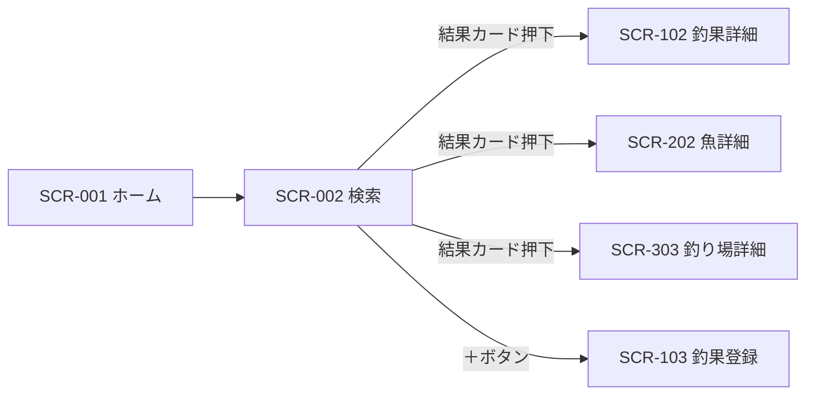

# SCR-002 検索画面

## 1. 基本情報
| 項目 | 内容 |
| --- | --- |
| 画面ID | SCR-002 |
| 画面名 | 検索画面 |
| URL・パス | `/search` |
| 概要（1行） | 釣果・魚・釣り場を横断的に検索し、カテゴリ別に結果を表示する |
| 対象ユーザー・権限 | 全ユーザー（権限による出し分けは保留 → [README.md](./README.md) の「権限の扱い」） |
| 関連画面 | SCR-001 ホーム画面 / SCR-003 お気に入り画面 / SCR-102 釣果詳細画面 / SCR-103 釣果登録画面 / SCR-202 魚詳細画面 / SCR-302 地図画面 / SCR-303 釣り場詳細画面 |
| ステータス | 下書き |
| デザインカンプ | [Figma: セリオ釣りMAP ＞ 検索（node-id=1158-2009）](https://www.figma.com/design/LgJDTLLmkMfjeamo0zQl2b/%E3%82%BB%E3%83%AA%E3%82%AA%E9%87%A3%E3%82%8AMAP?node-id=1158-2009) |

## 2. 画面概要
キーワードで釣果・魚・釣り場を横断的に検索する画面です。
グローバルナビの「検索」に対応します。
画面上部に検索バーと絞り込みチップを置き、その下にカテゴリ（魚・釣り場など）ごとの見出しで結果をグルーピングして表示します。
結果のカードから各詳細画面へ遷移します。

## 3. 画面レイアウト
レイアウトの正典はFigmaです。共有サイドバーの右側にメインコンテンツを配置します。
メインコンテンツは、検索バー、結果カテゴリの絞り込みチップ、並び替え、カテゴリ別の検索結果で構成します。検索前は検索バーとチップを表示し、検索結果は表示しません。

- **Figma フレーム URL**: https://www.figma.com/design/LgJDTLLmkMfjeamo0zQl2b/%E3%82%BB%E3%83%AA%E3%82%AA%E9%87%A3%E3%82%8AMAP?node-id=1158-2009
- 検索結果は「釣果」「魚」「釣り場」の順にグルーピングします。
- 各カテゴリは初期表示3件までとし、「もっと見る」で該当カテゴリに絞った一覧を表示します。
- 初期状態の並び順は「関連度順」。利用者が「新着順」に切り替えられます。
- 検索キーワードはURLのクエリパラメータに反映し、再読み込み・共有・ブラウザバック後も復元します。

簡易ワイヤー（検索後の表示例）:

```text
┌────────┬────────────────────────────────────────────────────────────┐
│共有    │ [魚・釣り場・釣果を検索                         ×]          │
│サイド  │ [✓ すべて] [釣果] [魚] [釣り場]          並び順: 関連度順⌄ │
│バー    │                                                            │
│ map    │ 釣果                                      もっと見る →      │
│一覧    │ [写真] 10月15日（宇野港）の釣果                             │
│検索    │        アジ 3匹                                             │
│お気に入り│                                                            │
│ ＋     │ 魚                                       もっと見る →       │
│        │ [写真] チヌ                                                │
│        │        クロダイ                                             │
│        │                                                            │
│        │ 釣り場                                   もっと見る →       │
│        │ [写真] 宇野港                                              │
│        │        岡山県玉野市・最終釣果 10月12日                     │
└────────┴────────────────────────────────────────────────────────────┘
```

> 上記ワイヤーは採用する検索画面案です。現行Figmaへの反映は未完了です。

## 4. 画面項目
項目名とサンプル文言は本設計書の採用案です。現行Figmaには旧テンプレートのダミー表示が残っています。

| No | 項目名 | 種別 | 必須 | 説明・制約（桁数 / 形式 / 初期値 など） |
| --- | --- | --- | --- | --- |
| 1 | メニュー開閉ボタン（ハンバーガー） | ボタン | − | 共通サイドバーの開閉を切り替える |
| 2 | 釣果登録ボタン（＋） | ボタン | − | サイドバー上部、ナビ項目とは別枠。背景色付きの角丸で強調表示。全ユーザーに表示（保留: 会員のみ） |
| 3 | ナビ項目「map」 | リンク | − | アイコン＋ラベル |
| 4 | ナビ項目「一覧」 | リンク | − | アイコン＋ラベル |
| 5 | ナビ項目「検索」 | リンク | − | アイコン＋ラベル。本画面を選択状態にする |
| 6 | ナビ項目「お気に入り」 | リンク | − | アイコン＋ラベル。遷移先は SCR-003 お気に入り画面。**機能自体が保留**（[docs/tasks.md](../tasks.md) の T-38） |
| 7 | 検索実行ボタン | ボタン | − | キーワード入力後に検索を実行する。Enterキーでも実行可能 |
| 8 | 検索キーワード入力欄 | テキスト入力 | − | プレースホルダは「魚・釣り場・釣果を検索」。初期値は空。魚種名・釣り場名・釣果に関する語句を入力する |
| 9 | キーワード消去ボタン | ボタン | − | 入力欄に文字がある場合に表示し、押下で入力値を消去する |
| 10 | 結果カテゴリ絞り込みチップ | 単一選択チップ | − | 「すべて」「釣果」「魚」「釣り場」。初期選択は「すべて」。カテゴリ単位で検索結果を絞り込む |
| 11 | 検索結果グループ見出し | ラベル | − | 「釣果」「魚」「釣り場」の順に結果を区切る。該当結果がないカテゴリは表示しない |
| 12 | 検索結果カード | リンク | − | グループ内の結果1件分。カード全体を押下可能にし、該当する詳細画面へ遷移する |
| 13 | 結果サムネイル | 画像 | − | カードに表示する。画像がない場合はカテゴリに対応する共通プレースホルダーを表示する |
| 14 | 結果タイトル | ラベル | ○ | 釣果は「日付（釣り場名）の釣果」、魚は魚種名、釣り場は釣り場名を表示する |
| 15 | 結果サブテキスト | ラベル | − | 釣果は「魚種名＋匹数」、魚は通称または短い説明、釣り場は所在地と最終釣果日を表示する |

> モック中の黒い太枠（「検索」ナビ項目を囲む枠）は注目箇所を示す注記であり、UI 上の罫線ではありません。

## 5. アクション / イベント
ナビゲーションは共通サイドバーの定義に従います。

| 操作（トリガー） | 挙動（処理内容） | 遷移先・結果 |
| --- | --- | --- |
| ハンバーガー押下 | サイドバーの表示／非表示を切り替える（挙動は要確認） | 同画面でサイドバーの表示状態が変わる |
| 「＋」ボタン押下 | 釣果の新規登録へ進む | SCR-103 釣果登録画面へ遷移。利用条件は保留（会員機能） |
| ナビ「map」押下 | 地図画面へ遷移 | SCR-302 地図画面へ遷移 |
| ナビ「一覧」押下 | 一覧画面へ遷移 | SCR-101 釣果一覧画面へ遷移 |
| ナビ「お気に入り」押下 | お気に入り画面へ遷移 | SCR-003 お気に入り画面へ遷移。**機能自体が保留**（T-38） |
| 検索キーワード入力 | 入力欄に検索語を入力する | 入力後、検索ボタンまたはEnterで検索を実行する |
| 検索実行（検索ボタン押下 / Enter） | 入力キーワードで検索し、結果をカテゴリ別に表示する | 同画面で検索結果が更新され、URLのクエリに検索語を反映する |
| 結果カテゴリチップ押下 | 選択カテゴリに応じて結果を絞り込む | 同画面で選択状態と検索結果が更新される |
| 並び順変更 | 関連度順／新着順を切り替える | 同画面で各カテゴリ内の順序が更新される |
| 「もっと見る」押下 | 選択カテゴリの全検索結果を表示する | 同画面で当該カテゴリの結果を一覧表示する |
| 検索結果カード押下（魚） | 当該の魚の詳細へ進む | SCR-202 魚詳細画面へ遷移 |
| 検索結果カード押下（釣り場） | 当該の釣り場の詳細へ進む | SCR-303 釣り場詳細画面へ遷移 |
| 検索結果カード押下（釣果） | 当該の釣果の詳細へ進む | SCR-102 釣果詳細画面へ遷移 |

## 6. 表示・状態
表示条件と、状態ごとの見せ方を記入する。該当しない状態の行は削除してよい。

| 状態 | 表示条件 | 表示内容 |
| --- | --- | --- |
| 通常（検索前） | 画面表示直後、キーワード未入力 | 検索バーと絞り込みチップのみを表示し、**検索結果は何も表示しない**（Figma の注釈「最初は何も表示しない」）。おすすめ・履歴なども出さない |
| 通常（検索後） | 検索結果が1件以上 | 釣果・魚・釣り場の順にカテゴリ別結果を表示。各カテゴリの初期表示は最大3件。「もっと見る」で残りを表示 |
| ローディング | 検索結果の取得中 | 結果カードのスケルトンを表示し、検索処理中であることを示す |
| データ空（Empty） | 検索結果が0件 | 「検索結果が見つかりませんでした」と表示し、キーワードやカテゴリを見直せるようにする |
| エラー | 取得・通信失敗 | 「検索に失敗しました」と再試行ボタンを表示する |

## 7. 画面遷移
- **遷移元**: SCR-001 ホーム画面（グローバルナビ「検索」）／全画面のグローバルナビ
- **遷移先**: SCR-102 釣果詳細画面 / SCR-202 魚詳細画面 / SCR-303 釣り場詳細画面 / SCR-103 釣果登録画面（＋ボタン）



全体の遷移は [screen-transition.md](./screen-transition.md) を参照してください。

## 8. 備考・課題
〇は本仕様で方針決定済み、×はFigma反映または追加のプロダクト判断が残っています。Figma連携の利用上限に達しているため、この更新では仕様案と簡易ワイヤーを整えましたが、デザインへの反映はできていません。

| 状況 | No. | 課題 | 内容・対応 |
| --- | ---: | --- | --- |
| × | 1 | ナビの選択状態 | 本画面では共通サイドバーの「検索」を選択状態にする案を採用。現行Figmaへの反映待ちです。 |
| 〇 | 2 | 検索バー内の重複アイコン | 検索バー左側の不要なメニューボタンは置かず、検索実行と入力消去の操作に整理しました。 |
| 〇 | 3 | 絞り込みチップの選択肢 | 「すべて／釣果／魚／釣り場」の単一選択とし、初期値を「すべて」にする案を採用しました。 |
| 〇 | 4 | ナビ項目と遷移先 | 共通サイドバーのリンク定義を使用します。検索結果の遷移先は魚→SCR-202、釣り場→SCR-303、釣果→SCR-102です。 |
| 〇 | 5 | 検索結果カテゴリと並び | 「釣果／魚／釣り場」の順に表示し、該当結果のないカテゴリは非表示にする案を採用しました。 |
| 〇 | 6 | 結果カードのサブテキスト | 釣果は魚種名と匹数、魚は通称または短い説明、釣り場は所在地と最終釣果日を表示する案を採用しました。 |
| 〇 | 7 | 表示件数・並び順 | 各カテゴリを初期3件まで表示し、「もっと見る」で残りを表示します。初期順は関連度順、切替候補は新着順です。 |
| 〇 | 8 | 検索キーワードのURL反映 | `/search?q=...` で検索語を保持し、再読み込み・共有・ブラウザバック後に復元する案を採用しました。 |
| × | 9 | 共通ナビのアイコン | 共通サイドバーのアイコンを使用する方針です。検索画面上の検索・消去・並び替えアイコンの最終選定はFigma反映時に確認します。 |
| 〇 | 10 | FigmaフレームURL | 基本情報とレイアウトに対象フレームURLを記載しています。 |
| 〇 | 11 | 対象デバイスの記述 | この仕様書ではデバイス別・画面幅別の記述を省き、対象画面の構成と操作に絞りました。 |
| × | 12 | 並び替えUI | 「関連度順／新着順」を選ぶUIを追加する案を採用しました。現行Figmaへの反映待ちです。 |
| × | 13 | テンプレートのダミー要素 | 英語のプレースホルダー文言と不要な非表示ナビ項目を整理する必要があります。Figma反映待ちです。 |
| 〇 | 14 | 検索前・読み込み・0件・エラー状態 | 検索前は結果なし、読み込み中はスケルトン、0件は案内文、エラー時は再試行ボタンを表示する案を採用しました。 |

---

### 更新履歴
| 日付 | 版 | 変更内容 | 担当 |
| --- | --- | --- | --- |
| 2026-08-14 | 0.1 | 新規作成（モック画像から起こした骨子） | 中村 |
| 2026-08-31 | 0.2 | Figmaフレームとキャンバス注釈を反映。検索前の表示、フィルターチップの位置づけを記録 | 中村 |
| 2026-08-31 | 0.3 | Figmaフレームと設計書の差分確認、記述整理 | 中村 |
| 2026-10-16 | 0.4 | 絞り込み・カテゴリ別表示・並び順・カード情報・状態の仕様案と簡易ワイヤーを更新。デバイス別記述を削除。Figma反映待ちの課題を明示 | 中村 |
