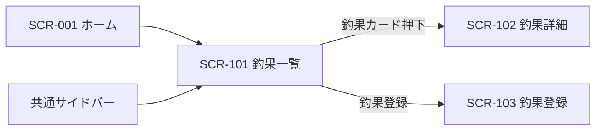

# SCR-101 釣果一覧画面

## 1. 基本情報
| 項目 | 内容 |
| --- | --- |
| 画面ID | SCR-101 |
| 画面名 | 釣果一覧画面 |
| URL・パス | `/catches` |
| 概要（1行） | 投稿された釣果をカード形式で一覧表示する |
| 対象ユーザー・権限 | 全ユーザー（権限による出し分けは保留 → [README.md](./README.md) の「権限の扱い」） |
| 関連画面 | SCR-001 ホーム画面 / SCR-002 検索画面 / SCR-003 お気に入り画面 / SCR-102 釣果詳細画面 / SCR-103 釣果登録画面 / SCR-201 魚一覧画面 / SCR-301 釣り場一覧画面 / SCR-302 地図画面 / SCR-303 釣り場詳細画面 |
| ステータス | 下書き |
| デザインカンプ | [Figma: セリオ釣りMAP ＞ 釣果一覧（node-id=1159-2799）](https://www.figma.com/design/LX5UAOYXjKxQougVqVzViq?node-id=1159-2799) |

## 2. 画面概要
投稿された釣果をカードで一覧表示します。共有サイドバーを使い、本画面では釣果一覧を選択状態にします。
画面上部に「釣果一覧」の見出しと絞り込みチップを置き、その下に釣果カードを並べます。カードのタイトルは「月日＋（釣り場名）の釣果」とし、サブタイトルには魚種名と匹数を表示します。サイズ（cm）は表示しません。カード押下で釣果詳細に遷移します。

## 3. 画面レイアウト
レイアウトの正典はFigmaです。ワイヤーは画面構成と操作対象を示します。

- **Figma フレーム URL**: https://www.figma.com/design/LX5UAOYXjKxQougVqVzViq?node-id=1159-2799
- 共有サイドバーの右側にメインコンテンツを配置します。
- メインコンテンツは、見出し「釣果一覧」、絞り込みチップ、釣果カードグリッドで構成します。
- Figmaには22件のサンプルカードを配置しています。カードの実データ件数は別途決定します。

簡易ワイヤー（カードはサンプル22件。下方向に続く）:

```text
┌────────┬────────────────────────────────────────────────────────────┐
│共有    │ 釣果一覧                                                   │
│サイド  │ [✓ すべて] [魚種] [釣り場] [期間] [サイズ]                 │
│バー    │                                                            │
│ map    │ [写真] 10月15日（宇野港）の釣果   …（5列）                   │
│一覧    │        アジ 3匹                                           │
│        │ [写真] 10月15日（下津井）の釣果                           │
│        │        チヌ 1匹                                           │
│検索    │                                                            │
│お気に入り│ 22件のカード。さらに下へスクロール                        │
│ ＋     │                                                            │
└────────┴────────────────────────────────────────────────────────────┘
```

## 4. 画面項目

| No | 項目名 | 種別 | 必須 | 説明・制約（桁数 / 形式 / 初期値 など） |
| --- | --- | --- | --- | --- |
| 1 | 共有サイドバー | 共通コンポーネント | − | 共通コンポーネントを使用。本画面では釣果一覧（`tyokaList`）を選択状態にする。ナビ項目と釣果登録ボタンを含む |
| 2 | 画面タイトル | ラベル | ○ | 「釣果一覧」。魚種や釣り場の絞り込み条件をタイトルには含めない |
| 3 | 絞り込みチップ | 単一選択チップ | − | 「すべて」「魚種」「釣り場」「期間」「サイズ」。初期選択は「すべて」。選択肢は今回の設計案 |
| 4 | 釣果カード | リンク | − | カード全体が釣果詳細へのリンク。Figma上のサンプルは22件 |
| 5 | 釣果写真 | 画像 | − | カード上部に表示。現在のFigma画像はサンプル素材で、釣果ごとの写真は未設定 |
| 6 | 釣果カードタイトル | ラベル | ○ | 「月日＋（釣り場名）の釣果」の形式。例：「10月15日（宇野港）の釣果」。魚種名はタイトルに含めない。Figma上はサンプルデータ |
| 7 | 魚種・匹数 | ラベル | ○ | サブタイトルに魚種名と釣果数を表示。例：「アジ 3匹」。サイズ（cm等）は表示しない。Figma上はサンプルデータ |

## 5. アクション / イベント

| 操作（トリガー） | 挙動（処理内容） | 遷移先・結果 |
| --- | --- | --- |
| サイドバーのナビ項目押下 | 共通ナビの定義に従って画面遷移 | 「map」→SCR-302、「釣果一覧」→SCR-101、「釣り場一覧」→SCR-301、「検索」→SCR-002、「お気に入り」→SCR-003（機能保留） |
| サイドバーの釣果登録ボタン押下 | 釣果の新規登録へ進む | SCR-103（仮）。利用条件は保留 |
| 絞り込みチップ押下 | 選んだ条件に応じて釣果一覧を絞り込む | 同画面で選択状態とカード一覧を更新 |
| 釣果カード押下 | 該当する釣果の詳細を表示 | SCR-102 釣果詳細画面 |
| 一覧をスクロール | 続きの釣果カードを表示 | 同画面。追加読み込み・ページング方式は未定 |

## 6. 表示・状態
ローディング状態のFigmaフレーム: https://www.figma.com/design/LX5UAOYXjKxQougVqVzViq?node-id=3702-3163

| 状態 | 表示条件 | 表示内容 |
| --- | --- | --- |
| 通常 | 釣果データが取得でき、該当釣果が1件以上 | 絞り込みチップと釣果カードを表示。Figmaのサンプルは5列・22件 |
| ローディング | 一覧データの取得中 | 「釣果一覧 / 読み込み中」フレームを表示。カード型スケルトンで写真・魚種・釣り場等の読み込み中を表現 |
| データ空 | 該当データが0件 | 案内文と絞り込み解除の導線は未定 |
| エラー | 取得・通信失敗 | エラー表示と再試行方法は未定 |
| 権限なし | — | **保留**（ログイン機能を実装しないため当面は発生しない → [README.md](./README.md) の「権限の扱い」） |

## 7. 画面遷移
- **遷移元**: SCR-001 ホーム画面 / 共通サイドバーの釣果一覧 / SCR-303 釣り場詳細画面（見出し横アイコンの導線は仮）
- **遷移先**: SCR-102 釣果詳細画面 / SCR-103 釣果登録画面（サイドバーの釣果登録ボタン）



全体の遷移は [screen-transition.md](./screen-transition.md) を参照してください。

## 8. 備考・課題
〇はFigmaまたは共通コンポーネントで対応済み、×は仕様・素材・挙動が未確定です。画面に採用した設計案は採用案として記録しています。

| 状況 | No. | 課題 | 内容・対応 |
| --- | ---: | --- | --- |
| 〇 | 1 | 画面タイトルと画面内容 | タイトルを「釣果一覧」にし、魚一覧ではなく釣果の一覧画面として整理しました。 |
| 〇 | 2 | タイトルと絞り込み条件 | タイトルは固定で「釣果一覧」とし、条件付きタイトルは使わない設計にしました。絞り込みはチップで表します。 |
| 〇 | 3 | 魚一覧・釣り場一覧とのレイアウト | 共有サイドバー、見出し、チップ、カードグリッドの構成に整理しました。カード内容は釣果向けです。 |
| 〇 | 4 | サイドバーの選択状態と遷移先 | 共有サイドバーを使用し、釣果一覧を選択状態にしました。共通コンポーネントにある釣果一覧・釣り場一覧へのリンクを使います。 |
| 〇 | 5 | 戻る操作 | サイドバーから開く一覧画面のため戻るボタンを削除しました。 |
| 〇 | 6 | ヘッダーアクションの用途 | 用途不明のアクションアイコンを画面から取り除きました。 |
| 〇 | 7 | 絞り込みチップ | 「すべて／魚種／釣り場／期間／サイズ」の単一選択を採用し、「すべて」を初期選択にしました。設計案としての採用です。 |
| 〇 | 8 | カードのタイトルと表示情報 | タイトルから魚種名を外し、「月日＋（釣り場名）の釣果」に変更しました。サブタイトルに「魚種名＋匹数」を表示し、サイズ（cm等）は表示しないようFigmaを修正しました。 |
| × | 9 | 釣果写真 | 現在の写真はサンプル素材です。釣果ごとの画像データと、写真がない場合の代替表示は未確定です。 |
| × | 10 | 表示件数・並び順 | Figmaの22件はサンプルです。実際の表示件数、並び順、追加読み込み方法は未確定です。 |
| × | 11 | お気に入り登録 | カードにお気に入り操作はありません。必要性はお気に入り機能（T-38）の方針と合わせて決定が必要です。 |
| 〇 | 12 | 共通サイドバー・重複ナビ | ブラウザバーと画面内の重複ナビを除去し、共有サイドバーを使用しています。 |
| × | 13 | 空・エラー状態 | ローディング状態はスケルトンカードで作成しました。データ空・通信エラー時の表示と再試行方法は未確定です。 |
| 〇 | 14 | Materialテンプレートの残り要素 | 重複画像・プレースホルダー文言・用途不明アクションを除去し、日本語の釣果サンプルに置き換えました。 |
| 〇 | 15 | プロトタイプ遷移 | 釣果カード22件すべてに、押下時に釣果詳細（SCR-102）へ遷移するプロトタイプを設定しました。 |

---

### 更新履歴
| 日付 | 版 | 変更内容 | 担当 |
| --- | --- | --- | --- |
| 2026-08-31 | 0.1 | 新規作成。Figmaフレームから項目表・アクション・状態を起こした | 中村 |
| 2026-10-16 | 0.2 | 釣果一覧の見出し、分類チップ、釣果カード、共通サイドバー、ローディング状態、SCR-102へのプロトタイプ遷移を反映。課題を〇／×で整理 | 中村 |
| 2026-10-16 | 0.3 | 各カードタイトルを月日・魚種名・釣り場入りの形式に統一し、サブテキストをサイズ表示に変更 | 中村 |
| 2026-10-16 | 0.4 | タイトルから魚種名を外し、サブタイトルを魚種名・匹数表示に変更。サイズ表示を削除 | 中村 |
