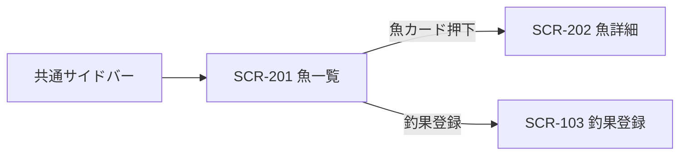

# SCR-201 魚一覧画面

## 1. 基本情報
| 項目 | 内容 |
| --- | --- |
| 画面ID | SCR-201 |
| 画面名 | 魚一覧画面 |
| URL・パス | `/fish` |
| 概要（1行） | 魚種を分類で絞り込み、図鑑形式のカード一覧で表示する |
| 対象ユーザー・権限 | 全ユーザー（権限による出し分けは保留 → [README.md](./README.md) の「権限の扱い」） |
| 関連画面 | SCR-001 ホーム画面 / SCR-002 検索画面 / SCR-003 お気に入り画面 / SCR-103 釣果登録画面 / SCR-202 魚詳細画面 / SCR-301 釣り場一覧画面 / SCR-302 地図画面 |
| ステータス | 下書き |
| デザインカンプ | [Figma: セリオ釣りMAP ＞ 魚一覧（node-id=1159-2325）](https://www.figma.com/design/LX5UAOYXjKxQougVqVzViq?node-id=1159-2325) |

## 2. 画面概要
魚種を図鑑形式で一覧表示する画面です。共有サイドバーでは「一覧」を選択状態にします。画面タイトルは「魚一覧」です。
分類チップで魚を絞り込み、魚カードから魚詳細画面へ移動します。Figmaには22件のサンプルカードを配置しています。

## 3. 画面レイアウト
レイアウトの正典はFigmaです。簡易ワイヤーは本書にも記載します。

- **Figma フレーム URL**: https://www.figma.com/design/LX5UAOYXjKxQougVqVzViq?node-id=1159-2325
- 共有サイドバーの右側にメインコンテンツを配置します。
- メインコンテンツは、タイトル「魚一覧」、分類チップ、5列の魚カードグリッドで構成します。
- Figmaのカードは22件です。件数・並び順の仕様は課題表を参照してください。
- 画面幅に応じた表示の詳細は本書では扱いません。

簡易ワイヤー（カードは全22件。下方向に続く）:

```text
┌────────┬────────────────────────────────────────────────────────────┐
│共有    │ 魚一覧                                                     │
│サイド  │ [✓ すべて] [海水魚] [淡水魚] [軟体類] [甲殻類]             │
│バー    │                                                            │
│        │ [魚影 アジ] [魚影 メバル] [魚影 カサゴ] [魚影 サヨリ] [魚影 カレイ]│
│ map    │  海水魚…    海水魚…     海水魚…     海水魚…      海水魚…    │
│一覧 ★ │                                                            │
│検索    │ [魚影 タコ] [魚影 アオリイカ] [魚影 クロダイ] [魚影 ブリ] [魚影 マダイ]│
│お気に入り│ …                                                      │
│ ＋     │                                                            │
└────────┴────────────────────────────────────────────────────────────┘
```

## 4. 画面項目

| No | 項目名 | 種別 | 必須 | 説明・制約（桁数 / 形式 / 初期値 など） |
| --- | --- | --- | --- | --- |
| 1 | 共有サイドバー | 共通コンポーネント | − | 共通コンポーネントを使用。本画面では「一覧」を選択状態にする。ナビ項目と釣果登録ボタンを含む |
| 2 | 画面タイトル | ラベル | ○ | 「魚一覧」。絞り込み条件を変えても固定 |
| 3 | 分類チップ | 単一選択チップ | − | 「すべて」「海水魚」「淡水魚」「軟体類」「甲殻類」。初期選択は「すべて」。選択肢は今回の設計案 |
| 4 | 魚カード | リンク | − | 5列グリッド。Figma上のサンプルは22件。カード全体から該当する魚詳細へ遷移 |
| 5 | 魚サムネイル | 画像 | − | 魚種共通の魚影イラストを仮表示。魚種ごとの写真素材・画像なしの場合の仕様は課題表を参照 |
| 6 | 魚名 | ラベル | ○ | Figmaに記載した魚名を表示。標準和名を使う想定 |
| 7 | 分類サブテキスト | ラベル | − | 魚の分類を日本語で表示。例：「海水魚・回遊魚」「軟体類」。表示分類はサンプル案 |

## 5. アクション / イベント

| 操作（トリガー） | 挙動（処理内容） | 遷移先・結果 |
| --- | --- | --- |
| サイドバーのナビ項目押下 | 共通ナビの定義に従って画面遷移 | 「map」→SCR-302、「一覧」→釣果一覧または釣り場一覧（共通コンポーネントのリンク定義を参照）、「検索」→SCR-002、「お気に入り」→SCR-003（機能保留） |
| サイドバーの釣果登録ボタン押下 | 釣果の新規登録へ進む | SCR-103（仮）。利用条件は保留 |
| 分類チップ押下 | 選んだ分類に該当する魚を表示。「すべて」を選ぶと絞り込みを解除 | 同画面で選択状態とカード一覧を更新 |
| 魚カード押下 | 該当する魚の詳細を表示 | SCR-202 魚詳細画面 |

## 6. 表示・状態
ローディング状態のFigmaフレーム: https://www.figma.com/design/LX5UAOYXjKxQougVqVzViq?node-id=3695-2663


| 状態 | 表示条件 | 表示内容 |
| --- | --- | --- |
| 通常 | 魚データが取得でき、該当魚が1件以上 | 分類チップと魚カードを表示。Figma上のサンプルは22件 |
| ローディング | 魚データの取得中 | 「魚一覧 / 読み込み中」フレームを表示。カード型スケルトンで画像・魚名・分類の読み込み中を表現 |
| データ空 | 該当魚が0件 | 案内文と絞り込み解除の導線は未定（課題表参照） |
| エラー | 取得・通信失敗 | エラー表示と再試行方法は未定（課題表参照） |

## 7. 画面遷移
- **遷移元**: 共通サイドバー「一覧」（リンク先は共通コンポーネントの定義に従う）
- **遷移先**: SCR-202 魚詳細画面 / SCR-103 釣果登録画面（サイドバーの釣果登録ボタン）



全体の遷移は [screen-transition.md](./screen-transition.md) を参照してください。

## 8. 備考・課題
〇はFigmaまたは共有コンポーネントで対応済み、×は仕様・素材・挙動が未確定です。設計案を画面に反映した項目は、採用案として記録しています。

| 状況 | No. | 課題 | 内容・対応 |
| --- | ---: | --- | --- |
| 〇 | 1 | グローバルナビ「一覧」の選択状態 | 魚一覧では共有サイドバーの「一覧」を選択状態にしました。 |
| × | 2 | 「一覧」ナビの遷移先 | 共通コンポーネントに釣果一覧・釣り場一覧へのリンクがあります。魚一覧を含めた「一覧」リンクの遷移先・使い分けは共通仕様として確定が必要です。 |
| 〇 | 3 | 画面タイトル | 「魚一覧」を採用し、仕様書とFigmaで揃えました。 |
| 〇 | 4 | 戻る操作 | 魚一覧画面に戻るボタンは不要とし、Figmaから削除しました。 |
| 〇 | 5 | ヘッダーの用途不明アクション | 用途が不明だったアクションアイコンを画面から取り除きました。 |
| 〇 | 6 | 絞り込みチップ | 「すべて／海水魚／淡水魚／軟体類／甲殻類」の単一選択を採用し、「すべて」を初期選択にしました。設計案としての採用です。 |
| 〇 | 7 | 先頭カードへの画像重複 | 画像の重なりを解消し、カードを同じ構成で並べました。 |
| 〇 | 8 | カードのサブテキスト | 英語の更新日表示を取り除き、日本語の分類表示に置き換えました。 |
| × | 9 | 魚種ごとの写真素材 | 現在は共通の魚影イラストを仮表示しています。実写真を使うか、魚種別イラストを作るか、画像なしの代替表示をどうするかは未決定です。 |
| × | 10 | 表示件数・並び順 | Figmaの22件はサンプルです。実際の掲載件数、初期表示件数、並び順、追加読み込み方法は未確定です。 |
| × | 11 | お気に入り登録 | カードにお気に入り操作はありません。必要性はお気に入り機能（T-38）の方針と合わせて決定が必要です。 |
| 〇 | 12 | 共有サイドバーと重複ナビ | 画面独自のナビを除去し、共有サイドバーを使用しています。 |
| × | 13 | 空・エラー状態 | ローディング中はカード型スケルトンを表示する画面をFigmaに追加しました。データ空・通信エラー時の表示と再試行動作は未確定です。 |
| 〇 | 14 | Figmaの画面内容と仕様書の不一致 | タイトル、分類チップ、魚名・分類、カード構成を今回のFigmaに合わせて更新しました。 |
| 〇 | 15 | プロトタイプ遷移 | 魚カード22件すべてに、押下時に魚詳細画面（SCR-202）へ遷移するプロトタイプを設定しました。 |

---

### 更新履歴
| 日付 | 版 | 変更内容 | 担当 |
| --- | --- | --- | --- |
| 2026-08-14 | 0.1 | 新規作成（モック画像から起こした骨子） | （記入） |
| 2026-08-31 | 0.2 | Figma フレーム（node-id=1159-2325）から項目表を反映 | （記入） |
| 2026-08-31 | 0.3 | Figmaフレームとの記述差分を確認し、仕様書を整理 | （記入） |
| 2026-10-16 | 0.4 | 魚一覧の見出し、分類チップ、22種の魚名・分類、共有サイドバー、魚影の仮画像を反映。課題を〇／×で整理 | 中村 |
| 2026-10-16 | 0.5 | 戻るボタンを削除し、ローディング状態と魚カードからSCR-202へのプロトタイプ遷移を追加 | 中村 |
