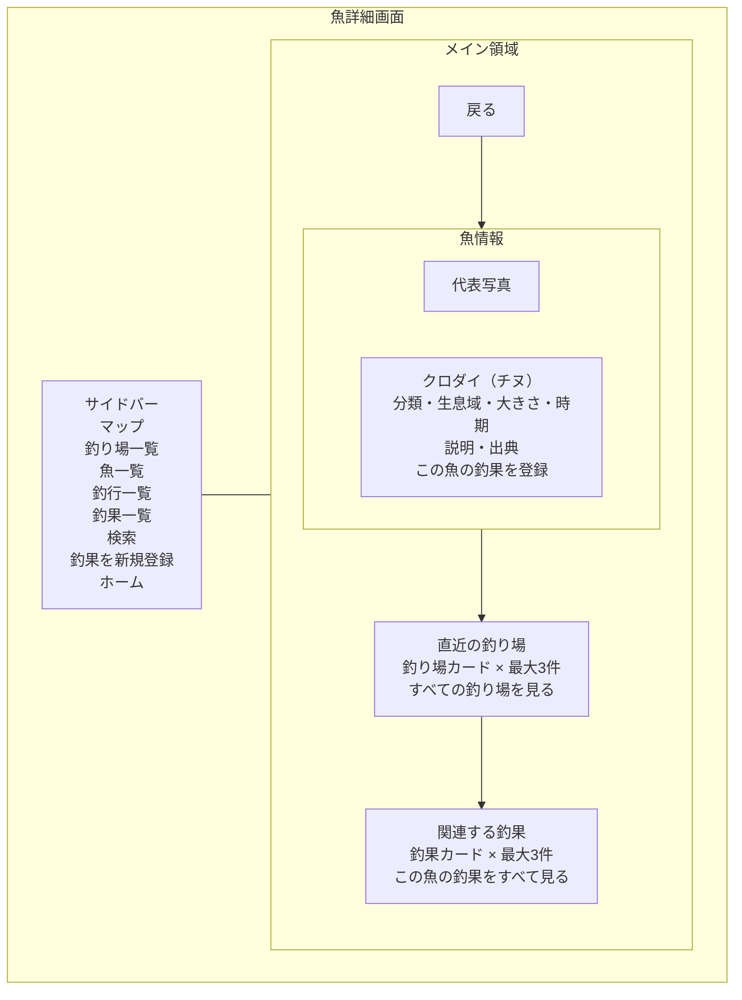
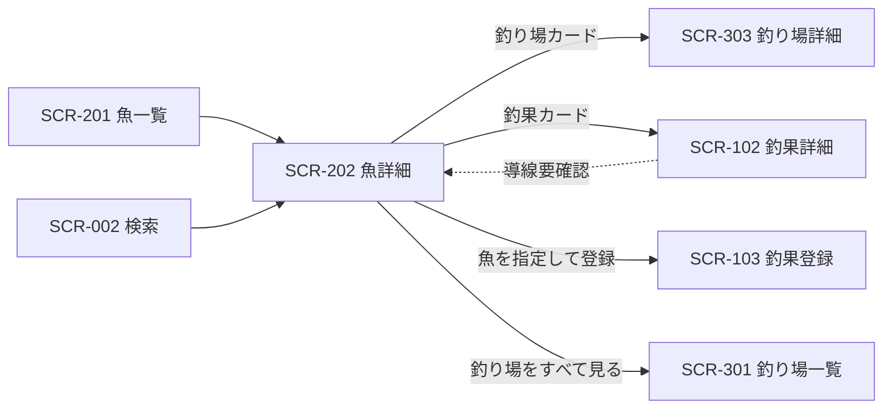

# SCR-202 魚詳細画面

## 1. 基本情報

| 項目 | 内容 |
| --- | --- |
| 画面ID | SCR-202 |
| 画面名 | 魚詳細画面 |
| URL・パス | `/fish/:id` |
| 概要 | 魚種の図鑑情報、直近の釣り場、関連する釣果を表示する |
| 対象ユーザー・権限 | 全ユーザー。権限による表示切り替えは保留（[README.md](./README.md)「権限の扱い」参照） |
| 関連画面 | SCR-002 検索画面 / SCR-003 お気に入り画面 / SCR-102 釣果詳細画面 / SCR-103 釣果登録画面 / SCR-201 魚一覧画面 / SCR-301 釣り場一覧画面 / SCR-303 釣り場詳細画面 |
| ステータス | 下書き |
| デザインカンプ | [Figma: 魚詳細画面](https://www.figma.com/design/LX5UAOYXjKxQougVqVzViq?node-id=3626-2011) |
| 共通コンポーネント | [Figma: SCR-202 共通コンポーネント](https://www.figma.com/design/LX5UAOYXjKxQougVqVzViq?node-id=3623-1687) |
| 状態一覧 | [Figma: 魚詳細の表示状態](https://www.figma.com/design/LX5UAOYXjKxQougVqVzViq?node-id=3626-2456) |

> 本仕様の画面レイアウトは「魚詳細画面」を正典とします。魚の説明や属性は図鑑情報、釣り場・釣果の日時と件数は画面構成を示すサンプルです。サンプル値を実データとして扱わないでください。

## 2. 画面概要

魚種1件の図鑑情報を表示します。魚の代表写真、標準和名、通称、分類、生息域、大きさの目安、釣れる時期、説明文を上部に配置します。下部には、その魚が釣れた釣り場と関連する釣果をそれぞれ新しい順に表示します。

魚一覧・検索・釣果詳細から到達します。戻る操作は遷移元へ戻り、履歴がない状態で直接開かれた場合は魚一覧へ戻ります。

## 3. 画面レイアウト

左側に固定幅のサイドバー、右側に可変幅のメイン領域を置きます。サイドバーの幅は192pxです。詳細画面ではナビ項目を選択状態にしません。

メイン領域は上から詳細ヘッダー、魚情報、直近の釣り場、関連する釣果の順に配置し、ヘッダー以外は縦方向にスクロールします。魚情報は左に代表写真、右に魚名・通称・属性・説明・釣果登録ボタンを置く2カラム構成です。釣り場と釣果はカードを縦に並べます。

- **Figmaフレーム**: [魚詳細画面](https://www.figma.com/design/LX5UAOYXjKxQougVqVzViq?node-id=3626-2011)
- **共通コンポーネント**: [SCR-202 共通コンポーネント](https://www.figma.com/design/LX5UAOYXjKxQougVqVzViq?node-id=3623-1687)
- **表示状態**: [魚詳細の表示状態](https://www.figma.com/design/LX5UAOYXjKxQougVqVzViq?node-id=3626-2456)

### 簡易ワイヤー

Figmaでは、画像・属性・ボタンなどの部品を、魚情報やカードなどのまとまりに組み合わせ、さらに詳細画面テンプレートに配置しています。繰り返し利用・一括変更・状態管理が必要な要素をコンポーネント化します。

## 4. 画面項目

Figma上の表示例はクロダイ（通称：チヌ）です。釣り場・釣果の名称や日時・件数はサンプルであり、実データは魚IDに紐づくレコードを表示します。

| No. | 項目 | 種別 | 表示・制約 |
| --- | --- | --- | --- |
| 1 | メニュー開閉 | ボタン | サイドバーを展開・折りたたみする |
| 2 | サイドバーナビゲーション | リンク | マップ、釣り場一覧、魚一覧、釣行一覧、釣果一覧、検索、釣果を新規登録、ホーム。詳細画面ではいずれも未選択 |
| 3 | 戻る | リンク | 左矢印と「戻る」。履歴があれば遷移元へ戻り、履歴がなければ魚一覧へ進む |
| 4 | 魚の代表写真 | 画像 | 1枚を表示。画像未登録時は共通の写真なし表示を使う |
| 5 | 標準和名 | 見出し | 必須。例：クロダイ |
| 6 | 通称 | ラベル | 登録がある場合に表示。例：チヌ |
| 7 | 魚の属性 | 属性カード | 分類、生息域、大きさの目安、釣れる時期を表示。値が未登録の場合は「情報未登録」 |
| 8 | 魚の説明 | テキスト | 日本語の説明を表示。段落・改行を保持し、全文表示する |
| 9 | 情報出典 | テキスト／リンク | 図鑑情報の出典。例：Honda 釣魚図鑑「クロダイ」 |
| 10 | 魚を引き継いで釣果登録 | ボタン | 「この魚の釣果を登録」。遷移先で当該魚を初期値として扱う |
| 11 | 直近の釣り場 | セクション | 当該魚の釣果がある釣り場を、新しい釣果日時順に最大3件表示。同一釣り場は重複させない |
| 12 | 釣り場一覧へのリンク | リンク | 「すべての釣り場を見る」。当該魚で絞り込んだ釣り場一覧へ進む |
| 13 | 釣り場カード | リンク | 釣り場の正式名、説明、最終釣果日時、サムネイルを表示。カード全体から釣り場詳細へ進む |
| 14 | 釣果なし画像 | 画像 | 釣り場写真が未登録の場合、共通の代替アイコンを表示 |
| 15 | 関連する釣果 | セクション | 当該魚に紐づく釣果を釣行日時の新しい順に最大3件表示 |
| 16 | 釣果一覧へのリンク | リンク | 「この魚の釣果をすべて見る」。当該魚に紐づく釣果一覧へ進む |
| 17 | 釣果カード | リンク | 魚名、サイズ、匹数、釣り場名、釣行日時を表示。釣果詳細へ進む |
| 18 | サイドバーの釣果登録 | ボタン | 「釣果を新規登録」。魚を特定せず、通常の釣果登録へ進む |
| 19 | サンプル表示の注記 | テキスト | 「表示例：釣り場・釣果の日時と件数はサンプルです。」。デザイン確認用の注記 |

## 5. アクション／イベント

| 操作 | 挙動 | 遷移先・結果 |
| --- | --- | --- |
| メニュー開閉ボタン | サイドバーの表示状態を切り替える | 同画面 |
| サイドバー「マップ」 | 地図画面を開く | SCR-302 |
| サイドバー「釣り場一覧」 | 釣り場一覧を開く | SCR-301 |
| サイドバー「魚一覧」 | 魚一覧を開く | SCR-201 |
| サイドバー「検索」 | 検索画面を開く | SCR-002 |
| サイドバー「釣果を新規登録」 | 魚を事前選択せず釣果登録を開始する | SCR-103 |
| 戻る | 履歴があれば直前の画面へ戻る。履歴がなければ魚一覧へ進む | 遷移元、または SCR-201 |
| 「この魚の釣果を登録」 | 現在の魚を初期選択した釣果登録を開始する | SCR-103 |
| 「すべての釣り場を見る」 | 現在の魚で釣り場を絞り込む | SCR-301 |
| 釣り場カード | 選択した釣り場の詳細を開く | SCR-303 |
| 「この魚の釣果をすべて見る」 | 現在の魚に紐づく釣果一覧を開く | 釣果一覧画面。画面IDは要確認 |
| 釣果カード | 選択した釣果の詳細を開く | SCR-102 |
| 再読み込み | 失敗した釣り場データの取得を再試行する | 同画面 |
| 「魚一覧へ」 | 存在しない魚の案内から魚一覧へ戻る | SCR-201 |

> Figma上の見た目とコンポーネントは作成済みです。プロトタイプの遷移設定、およびアプリ上でのデータ引き継ぎは別途実装・確認してください。

## 6. 表示・状態

| 状態 | 条件 | 表示 |
| --- | --- | --- |
| 通常 | 魚データを取得でき、対象の釣り場・釣果データがある | 魚情報、直近の釣り場、関連する釣果を表示する |
| 釣り場なし | 魚は存在するが釣り場データが0件 | 直近の釣り場欄に「釣り場はまだありません」と案内し、魚を引き継いで釣果を登録するボタンを表示する |
| 関連釣果なし | 魚は存在するが釣果データが0件 | 関連する釣果欄に専用の案内文を表示する。釣り場なしの文言を流用しない |
| ローディング | 魚または関連データを取得中 | 対象領域にスケルトンを表示する |
| 通信エラー | 魚情報または必須データの取得に失敗 | エラー案内と再読み込みボタンを表示する |
| 存在しない魚 | 指定IDの魚が存在しない | 該当する魚がない旨を案内し、「魚一覧へ」を表示する |
| 釣り場のみ取得失敗 | 魚情報は表示できるが、釣り場データの取得に失敗 | 魚情報・取得できた関連釣果を残し、釣り場欄に再読み込みを表示する |
| 魚の写真なし | 魚の画像が未登録 | 写真なしアイコンと「写真はまだありません」を表示する |
| 釣り場の写真なし | 釣り場の画像が未登録 | 釣り場カードに共通の代替アイコンを表示する |
| 権限なし | 現行では該当なし | ログイン・権限機能の扱いは [README.md](./README.md)「権限の扱い」に従う |

**Figma上での確認事項:** 表示状態フレームでは、「関連釣果が0件」を含む複数の状態に釣り場なしのタイトル・説明が流用されています。実装および画面確定時には、上表の状態ごとに文言を分けてください。

## 7. 画面遷移

- **遷移元**: SCR-201 魚一覧画面（魚カード押下） / SCR-002 検索画面（魚検索結果押下） / SCR-102 釣果詳細画面（導線は要確認）
- **遷移先**: SCR-301 釣り場一覧画面（魚で絞り込み） / SCR-303 釣り場詳細画面（釣り場カード） / SCR-102 釣果詳細画面（釣果カード） / SCR-103 釣果登録画面（登録ボタン） / SCR-201 魚一覧画面（戻る履歴がない場合・存在しない魚）

全体の遷移は [screen-transition.md](./screen-transition.md) を参照してください。釣果一覧画面の画面IDは画面一覧で確認し、リンク先を確定してください。

## 8. 備考・課題の対応状況

旧仕様書に記載していた課題の状態を以下に示します。〇は設計上の対応が完了、×は未解消または確認・決定が残っていることを表します。×の項目には、現在の扱いと残作業を記載しています。

| 状態 | No. | 旧課題 | 現在の扱い・残作業 |
| --- | ---: | --- | --- |
| 〇 | 1 | メインコンテンツの二重配置 | 採用する魚詳細コンテンツをFigmaで再構成。釣り場詳細の複製を除外 |
| 〇 | 2 | 詳細画面間のテンプレート重複 | Detail/Templateを用意し、魚情報・主要セクション・関連セクションを組み替える構成 |
| 〇 | 3 | 戻る文言と遷移元 | 表示文言を「戻る」に統一。履歴がない場合は魚一覧へ戻る方針 |
| 〇 | 4 | サイドバーの選択中表示 | 詳細画面では選択なし |
| 〇 | 5 | 釣果登録導線の重複 | サイドバーは通常登録、本文ボタンは現在の魚を初期値にする用途 |
| 〇 | 6 | ヘッダーアクションの用途不明 | 用途未定義のアクションを表示しない |
| 〇 | 7 | 魚の写真の扱い | 代表写真1枚。未登録時の代替表示あり |
| 〇 | 8 | 釣り場見出し横の操作が不明 | 操作ボタンを削除し、「すべての釣り場を見る」リンクに統一 |
| 〇 | 9 | 魚情報の編集導線 | 魚詳細画面に編集アイコンは置かず、魚情報の編集・削除はマスタ画面から行う |
| 〇 | 10 | Published date表示 | 削除し、分類・生息域・大きさ・釣れる時期を表示 |
| 〇 | 11 | 釣り場名の揺れ | 正式名称を表示。サンプルは「宇野港」 |
| 〇 | 12 | 日時・アイコンの意味不明 | 最終釣果日時として定義。用途不明アイコンを削除し、カード全体をリンクにする |
| 〇 | 13 | 図鑑情報・関連釣果が不足 | 属性カードと関連する釣果セクションを追加 |
| 〇 | 14 | 英語のダミー表示 | 画面文言を日本語に置き換え、サンプル値に注記 |
| 〇 | 15 | ナビアイコンが未確定 | ナビゲーションコンポーネントのアイコンを使用 |
| 〇 | 16 | レイアウト記述が未整備 | 画面構成を本仕様とFigmaフレームに記載 |
| 〇 | 17 | Materialテンプレートの残骸 | 画面内の不要な仮要素を削除 |

### 更新履歴

| 日付 | 版 | 変更内容 | 担当 |
| --- | --- | --- | --- |
| 2026-08-31 | 0.1 | Figmaの初期フレームから仕様を起票 | 山地 |
| 2026-10-16 | 0.2 | Figmaに合わせて全体を見直し。古いFigma URL、重複コンテンツ、用途不明要素、ダミー表記を更新。表示状態の文言不整合を記録 | 中村 |
| 2026-10-16 | 0.3 | 課題ごとに〇／×の状態を追加し、端末種別の記載を削除 | 中村 |
| 2026-10-16 | 0.4 | 魚情報の編集・削除はマスタ画面で行う方針を反映し、課題9を対応済みに変更 | 中村 |
| 2026-10-16 | 0.5 | 仕様書内に簡易ワイヤーを追加 | 中村 |

## 参考資料

- 魚の図鑑情報: [Honda 釣魚図鑑「クロダイ」](https://www.honda.co.jp/fishing/picture-book/kurodai/)
- 画面レイアウト: [Figma: 魚詳細画面](https://www.figma.com/design/LX5UAOYXjKxQougVqVzViq?node-id=3626-2011)
- 共通部品: [Figma: SCR-202 共通コンポーネント](https://www.figma.com/design/LX5UAOYXjKxQougVqVzViq?node-id=3623-1687)
- 表示状態: [Figma: 魚詳細の表示状態](https://www.figma.com/design/LX5UAOYXjKxQougVqVzViq?node-id=3626-2456)
