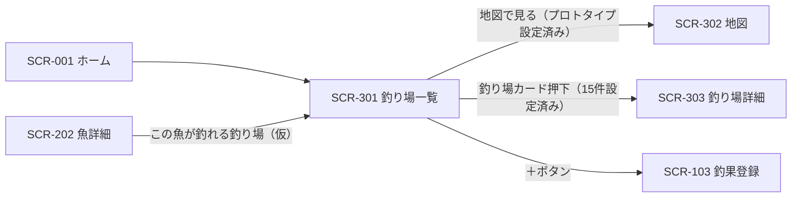

# SCR-301 釣り場一覧画面

## 1. 基本情報
| 項目 | 内容 |
| --- | --- |
| 画面ID | SCR-301 |
| 画面名 | 釣り場一覧画面 |
| URL・パス | `/spots` |
| 概要（1行） | 釣り場をカードのグリッドで一覧表示する（地図表示に切替可） |
| 対象ユーザー・権限 | 全ユーザー（権限による出し分けは保留 → [README.md](./README.md) の「権限の扱い」） |
| 関連画面 | SCR-001 ホーム画面 / SCR-002 検索画面 / SCR-003 お気に入り画面 / SCR-103 釣果登録画面 / SCR-202 魚詳細画面 / SCR-302 地図画面 / SCR-303 釣り場詳細画面 |
| ステータス | 下書き |
| デザインカンプ | [Figma: セリオ釣りMAP ＞ 釣り場一覧（node-id=1159-2582）](https://www.figma.com/design/LX5UAOYXjKxQougVqVzViq?node-id=1159-2582) |

## 2. 画面概要
釣り場をカードのグリッドで一覧表示する画面です。
サイドバーとメインコンテンツで構成します。画面上部に「釣り場一覧」と魚種「チヌ」での絞り込み状態を表示し、条件・件数・並べ替え操作の下に釣り場カードを並べます。

## 3. 画面レイアウト
**レイアウトの正典は Figma**。見た目の詳細は Figma を参照してください。

- **Figma フレーム URL**: https://www.figma.com/design/LX5UAOYXjKxQougVqVzViq?node-id=1159-2582
- メインコンテンツは、画面タイトルと絞り込み状態、絞り込み条件、件数・並べ替え、釣り場カード一覧、ページ送りで構成します。カードは15件です。

簡易ワイヤー（詳細は Figma が正典）:

```
+---+--------------------------------------+
| ≡ | 釣り場一覧              [地図で見る] |
|   | 魚種「チヌ」で絞り込み中             |
| ＋| [魚種：チヌ] [エリア] [設備] [釣果あり] |
|   | 条件をクリア              釣り場15件 |
|map| 並べ替え                               |
|   | +----------------+ +----------------+ |
|一覧| | 写真・釣り場名 | | 写真・釣り場名 | |
|   | | 所在地など     | | 所在地など     | |
|検索| +----------------+ +----------------+ |
|   |       … 釣り場カード一覧 …            |
|お気|             [ページ送り]              |
+---+--------------------------------------+
  ↑ サイドバー
```

> 画面項目（4.）・状態（6.）のテキストは Figma フレーム（node-id=1159-2582）から起こしています。

## 4. 画面項目
Figma の更新版フレームで確認できる要素を記載します。釣り場カードの名称・補足情報はサンプルです。

| No | 項目名 | 種別 | 必須 | 説明・制約 |
| --- | --- | --- | --- | --- |
| 1 | メニュー開閉ボタン | ボタン | − | サイドバー上部。サイドバーを展開・折りたたみする想定。プロトタイプ未設定 |
| 2 | 釣果登録ボタン（＋） | ボタン | − | サイドバー上部。SCR-103 への遷移を想定するが、プロトタイプ未設定 |
| 3 | サイドバーナビ | リンク | − | map／一覧／検索／お気に入り。画面ごとの遷移先は共通ナビ仕様で確定する |
| 4 | 画面タイトル | ラベル | ○ | 「釣り場一覧」 |
| 5 | 絞り込み状態 | ラベル | − | 「魚種『チヌ』で絞り込み中」 |
| 6 | 地図で見るボタン | ボタン | − | SCR-302 地図画面へ遷移。プロトタイプ設定済み |
| 7 | 絞り込み条件 | ボタン | − | 「魚種：チヌ」「エリア」「設備」「釣果あり」。選択・解除の動作は未設定 |
| 8 | 条件をクリア | ボタン | − | 絞り込みを解除する想定。プロトタイプ未設定 |
| 9 | 件数表示 | ラベル | − | 表示中の釣り場件数を表示 |
| 10 | 並べ替え | ボタン | − | 並べ替え条件・候補は未確定。プロトタイプ未設定 |
| 11 | 釣り場カード | リンク | − | 15件。カード全体から SCR-303 釣り場詳細画面へ遷移。15件すべて設定済み |
| 12 | 釣り場サムネイル | 画像 | − | 画像なしの場合の代替表示は未確定 |
| 13 | 釣り場名 | ラベル | ○ | 宇野港などの釣り場名を表示 |
| 14 | 補足情報 | ラベル | − | 所在地などを表示。内容・行数制限は未確定 |
| 15 | ページ送り | ボタン | − | 表示ページを切り替える想定。プロトタイプ未設定 |

## 5. アクション / イベント

| 操作 | 挙動 | 遷移先・結果 |
| --- | --- | --- |
| 「地図で見る」押下 | 地図表示に切り替える | SCR-302 地図画面へ遷移。プロトタイプ設定済み |
| 釣り場カード押下 | 選択した釣り場の詳細を表示する | SCR-303 釣り場詳細画面へ遷移。15件すべて設定済み |
| 絞り込み条件押下 | 条件の選択・解除を切り替え、一覧を絞り込む | 動作プロトタイプ未設定 |
| 「条件をクリア」押下 | 絞り込みを解除する | 動作プロトタイプ未設定 |
| 並べ替え押下 | 並び順の選択・適用を行う | 条件・画面状態とも未確定のため未設定 |
| ページ送り押下 | 表示するカードのページを切り替える | ページ状態の画面が未作成のため未設定 |
| サイドバーのホームボタン押下 | ホーム画面を表示する | ホーム画面への既存プロトタイプ設定あり |
| サイドバー「＋」押下 | 釣果登録を開始する | SCR-103 を想定。プロトタイプ未設定 |

プロトタイプでは、遷移先が確認できる「地図で見る」と釣り場カードに遷移を設定しています。その他の操作は状態差分や遷移先の画面が未作成のため、未設定です。

## 6. 表示・状態
表示条件と、状態ごとの見せ方を記載します。

| 状態 | 表示条件 | 表示内容 |
| --- | --- | --- |
| 通常 | 該当する釣り場が1件以上 | 絞り込みチップと釣り場カードのグリッドを表示する。モックは5列 |
| ローディング | 一覧データの取得中 | （記入） |
| データ空（Empty） | 該当データ 0 件 | （記入）— 絞り込みで0件になった場合の案内文・条件解除の導線を含めて要確認 |
| エラー | 取得・通信失敗 | （記入） |

## 7. 画面遷移
- **遷移元**: SCR-001 ホーム画面 / SCR-202 魚詳細画面（「この魚が釣れる釣り場」からの絞り込み遷移と推測、課題2参照）/ SCR-302 地図画面（一覧 ⇄ 地図 の表示切替）/ 全画面のグローバルナビ「一覧」
- **遷移先**: SCR-303 釣り場詳細画面 / SCR-302 地図画面（表示切替）/ SCR-103 釣果登録画面（＋ボタン、仮）



全体の遷移は [screen-transition.md](./screen-transition.md) を参照してください。

## 8. 備考・課題
以下に未確定事項と解消済み事項をまとめます。〇は解消済み、×は未解消です。

| 状態 | No | 課題・対応内容 |
| --- | --- | --- |
| 〇 | 1 | **グローバルナビ「一覧」の対応画面** — 解消。更新版ではサイドバーの「一覧」を選択中として表示しています。本画面が釣り場一覧であることが分かる状態です。 |
| × | 2 | **絞り込み条件のURL保持が未定** — 魚種「チヌ」での絞り込み表示を確認しました。条件なし一覧との切り替え、および URL に条件を持たせるか（`/spots?fish=...`）は要確認です。 |
| 〇 | 3 | **ナビの選択中表示** — 解消。釣り場一覧に対応する「一覧」を選択中にしました。 |
| 〇 | 4 | **戻るボタンの戻り先** — 解消。更新版の釣り場一覧画面から戻るボタンを削除しました。 |
| 〇 | 5 | **用途不明のヘッダーアクション** — 解消。用途が決まっていないアクションアイコンを削除し、地図表示への導線を「地図で見る」ボタンとして明示しました。 |
| 〇 | 6 | **地図表示への切替導線** — 解消。画面に「地図で見る」ボタンを追加し、SCR-302 地図画面へのプロトタイプ遷移を設定しました。 |
| × | 7 | **絞り込みチップの中身が未定・検索画面との関係が未整理** — モックは `Label` が5個で2番目が選択中と、[SCR-002 検索画面](./SCR-002-search.md) のチップと同一の見た目です。何で絞り込むのか（魚種／エリア／設備など）、単一選択か複数選択か、両画面で選択肢を共通化するかが要確認です。 |
| 〇 | 8 | **1枚目のカードだけ名称・サブテキストが無い** — 解消。Figma では釣り場カード15件が同じ構成（`Image` ＋ `Title` ＋ `Date`）です。モック画像で1枚目が写真のみに見えていたのは、カードグリッドの上に別レイヤーの画像（`image 4`）が重なっていたためでした。 |
| 〇 | 9 | **グリッドの列数** — 現在のデザインを5列にしました。 |
| × | 10 | **一覧の件数・ページング仕様が未定** — Figma は15枚とページ送りを表示しています。1ページの件数、並び順、ページ送りの動作は未確定です。 |
| × | 11 | **カードにお気に入りの導線が無い** — 一覧から登録できるようにするか要確認（お気に入り機能自体は T-38 で保留）。 |
| × | 12 | **カードの補足情報の仕様が未定** — 所在地など、表示内容と行数制限を確定する必要があります。 |
| × | 13 | **アイコンがすべてプレースホルダ** — 各ナビ項目の最終アイコンが未定。 |
| 〇 | 14 | **Figma フレーム URL** — 解消。「1. 基本情報」「3. 画面レイアウト」の両方に更新版URLを記載しました。 |
| × | 15 | **カード・各操作の表示内容が未確定** — 表示値、代替画像、アイコンの意味を確定し、画面項目と揃える必要があります。 |
| 〇 | 16 | **画面遷移プロトタイプ** — 解消。地図表示ボタンから SCR-302、釣り場カード15件から SCR-303 への遷移を設定しました。サイドバーのホームボタンは既存設定を確認しています。その他の操作は状態差分や遷移先が用意されていないため未設定です。 |
---

### 更新履歴
| 日付 | 版 | 変更内容 | 担当 |
| --- | --- | --- | --- |
| 2026-08-14 | 0.1 | 新規作成（モック画像から起こした骨子） | （記入） |
| 2026-08-14 | 0.2 | SCR-201 のモックを踏まえ、ナビ「一覧」の対応先に関する課題1を更新 | （記入） |
| 2026-08-31 | 0.3 | Figma フレーム（node-id=1159-2582）から項目表を反映。課題8・14 を解消し、ヘッダーアクションがテンプレ既定のままである旨を課題5 に反映 | （記入） |
| 2026-08-31 | 0.4 | Figma REST API（スキル `figma-sync`）で全フレームを再取得し、本設計書の記述と**差分なし**を確認。「3. 画面レイアウト」の Figma 取得に関する注記を [README.md](./README.md) の記述に合わせた | （記入） |
| 2026-10-16 | 0.5 | Figma の更新版フレーム URL、最新の画面構成と簡易ワイヤー、プロトタイプ遷移を反映。課題の解消状況を〇×で追記 | （記入） |
