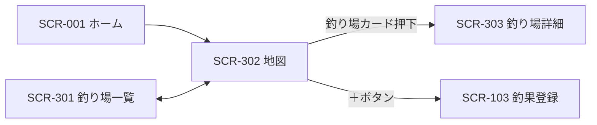

# SCR-302 地図画面

## 1. 基本情報
| 項目 | 内容 |
| --- | --- |
| 画面ID | SCR-302 |
| 画面名 | 地図画面 |
| URL・パス | `/map` |
| 概要（1行） | 釣り場を地図上に表示し、選択した釣り場の概要を画面下部のカードで確認する |
| 対象ユーザー・権限 | 全ユーザー（権限による出し分けは保留 → [README.md](./README.md) の「権限の扱い」） |
| 関連画面 | SCR-001 ホーム画面 / SCR-002 検索画面 / SCR-003 お気に入り画面 / SCR-101 釣果一覧画面 / SCR-103 釣果登録画面 / SCR-301 釣り場一覧画面 / SCR-303 釣り場詳細画面 |
| ステータス | 下書き |
| デザインカンプ | [Figma: セリオ釣りMAP ＞ map（node-id=1158-2110）](https://www.figma.com/design/LgJDTLLmkMfjeamo0zQl2b/%E3%82%BB%E3%83%AA%E3%82%AA%E9%87%A3%E3%82%8AMAP?node-id=1158-2110) |

## 2. 画面概要
釣り場を地図上に表示する画面です。
グローバルナビの「map」に対応し、地図から目的の釣り場を探す用途を担います。
元の共有サイドバーコンポーネントを使用し、本画面では「map」を選択状態で表示します。地図上の釣り場は赤い地図ピンで示します。
地図上で釣り場を選ぶと、画面下部にその釣り場の概要（写真・名称・所在地・釣れる魚種）がカードで表示され、詳細画面への入口になります。カードはサイドバーを除いた地図表示領域いっぱいに広げます。
サイドバー上部の「＋」から、釣果の登録へ直接進めます。

## 3. 画面レイアウト
**レイアウトの正典は Figma**。この設計書には対象フレームの URL を必ず記載する（「1. 基本情報＞デザインカンプ」と一致させる）。
見た目の詳細は Figma を参照し、ここでは URL とレイアウト方針・補足を扱う。

- **Figma フレーム URL**: https://www.figma.com/design/LgJDTLLmkMfjeamo0zQl2b/%E3%82%BB%E3%83%AA%E3%82%AA%E9%87%A3%E3%82%8AMAP?node-id=1158-2110
- 左側に元の共有サイドバーコンポーネント、右側に地図を配置します。釣り場カードはサイドバーを除いた地図表示領域の横幅いっぱいに、地図下部へ重ねて表示します。

簡易ワイヤー（詳細は Figma が正典）:

```
+---+--------------------------------------+
|   |                                      |
|   |       （地図：釣り場を赤ピン表示）   |
| ≡ |                                      |
| ＋|                                      |
| ● |                                      |
|map|                                      |
| ○ |                                      |
|一覧|                                      |
| ○ |                                      |
|検索|                                      |
| ○ |                                      |
|お気|                                      |
|   |                                      |
|   |                                      |
|   +--------------------------------------+|
|   |[写真] 宇野港                         |
|   |       所在地・釣れる魚種   詳細を見る→|
+---+--------------------------------------+
  ↑ 元の共有サイドバー     ↑ 地図表示領域いっぱいの釣り場カード
    ● = 現在地（map）
    赤ピン = 地図上の釣り場。選択した釣り場のカードを下部に表示
```

> 画面項目（4.）・状態（6.）のテキストは Figma フレーム（node-id=1158-2110）から起こしています。

## 4. 画面項目
モックから読み取れる要素のみを記載しています。モックに情報がない箇所は `（記入）` を残しています。

| No | 項目名 | 種別 | 必須 | 説明・制約（桁数 / 形式 / 初期値 など） |
| --- | --- | --- | --- | --- |
| 1 | メニュー開閉ボタン（ハンバーガー） | ボタン | − | 元の共有サイドバーコンポーネントを使用。折りたたみ操作は共通コンポーネントの仕様に従う |
| 2 | 釣果登録ボタン（＋） | ボタン | − | サイドバー上部、ナビ項目とは別枠。背景色付きの角丸で強調表示。全ユーザーに表示（保留: 会員のみ） |
| 3 | 共有サイドバーのナビ項目 | リンク | − | 共通コンポーネントの項目を表示。本画面では「Map」を選択状態にする。「釣果一覧」は SCR-101、「釣り場一覧」は SCR-301 へ遷移する |
| 4 | 地図 | 地図 | − | メインコンテンツ全面に表示。Figma の地図は編集可能な図形・地名で表したイメージ。実際に使用する地図サービス、初期表示位置、ズーム倍率は未確定。釣り場は赤い地図ピンで表示 |
| 5 | 釣り場カード | その他 | − | 地図下部に重ねて表示するカード。サイドバーを除いた地図表示領域いっぱいの横幅で表示。選択中の釣り場の概要を表示する |
| 6 | 釣り場サムネイル | 画像 | − | カード左側に表示。画像が無い場合の代替表示は（記入） |
| 7 | 釣り場名 | ラベル | ○ | 表示例は「宇野港」。桁数・省略表示（末尾省略）の要否は（記入） |
| 8 | 所在地 | ラベル | − | 表示例は「岡山県玉野市」。表示範囲・省略方法は（記入） |
| 9 | 釣れる魚種 | ラベル | − | 表示例は「チヌ、アジ」。読点区切り。表示件数の上限・並び順は（記入） |
| 10 | 釣り場詳細リンク | リンク | − | カード内に「釣り場詳細を見る」を表示し、選択中の釣り場詳細へ遷移する。カード全体も詳細画面へのリンクとして動作する |

## 5. アクション / イベント
サイドバーの「釣果一覧」「釣り場一覧」は共通コンポーネントに用意されたリンク先へ遷移します。

| 操作（トリガー） | 挙動（処理内容） | 遷移先・結果 |
| --- | --- | --- |
| ハンバーガー押下 | 共有サイドバーコンポーネントの表示状態を切り替える | 同画面でサイドバーの表示状態が変わる |
| 「＋」ボタン押下 | 釣果の新規登録へ進む | SCR-103 釣果登録画面へ遷移（仮）。条件なし（保留: 会員のみ） |
| サイドバー「釣果一覧」押下 | 釣果一覧を表示する | SCR-101 釣果一覧画面へ遷移 |
| サイドバー「釣り場一覧」押下 | 釣り場一覧を表示する | SCR-301 釣り場一覧画面へ遷移 |
| 地図上の釣り場（ピン）押下 | 当該釣り場の情報を画面下部のカードに表示する | 同画面でカードの内容が切り替わる |
| 地図のドラッグ・ズーム操作 | 表示範囲を変更する。範囲変更時に釣り場を再取得するかは要確認 | 同画面で地図の表示範囲が変わる |
| 釣り場カード押下 | 当該釣り場の詳細へ進む | SCR-303 釣り場詳細画面へ遷移（仮） |

## 6. 表示・状態
表示条件と、状態ごとの見せ方を記入する。該当しない状態の行は削除してよい。

| 状態 | 表示条件 | 表示内容 |
| --- | --- | --- |
| 通常 | 画面表示時 | 共有サイドバーと地図を表示する。サイドバーの「Map」は選択状態。釣り場を赤い地図ピンで表示する |
| 通常（釣り場選択中） | 地図上の釣り場を選択したとき | サイドバーを除く地図表示領域いっぱいの幅で、画面下部に釣り場カード（写真・名称・所在地・魚種・詳細リンク）を表示する |
| ローディング | 地図・釣り場データの取得中 | （記入） |
| データ空（Empty） | 表示範囲内に釣り場が 0 件 | （記入）— カードを出さずに地図のみ表示するのか、案内文を出すのか要確認 |
| エラー | 取得・通信失敗 | （記入） |
| 権限なし | — | **保留**（ログイン機能を実装しないため当面は発生しない → [README.md](./README.md) の「権限の扱い」） |

## 7. 画面遷移
- **遷移元**: SCR-001 ホーム画面 / SCR-301 釣り場一覧画面（一覧 ⇄ 地図 の表示切替）
- **遷移先**: SCR-303 釣り場詳細画面 / SCR-103 釣果登録画面（仮）/ SCR-101 釣果一覧画面 / SCR-301 釣り場一覧画面



全体の遷移は [screen-transition.md](./screen-transition.md) を参照してください。

## 8. 備考・課題
本設計書は当初ブラウザモック画像1枚から起こしたものですが、2026-08-31 に Figma フレーム（node-id=1158-2110）の内容を反映し、2026-10-16 に今回の画面修正を反映しました。Figma の地図は地形や地名を示すイメージであり、実サービスで使う地図仕様は未確定です。

| 状況 | No. | 課題 | 内容・対応 |
| --- | ---: | --- | --- |
| 〇 | 1 | ナビ項目が SCR-001 のモックと不一致 | Figma `version2.0` の正しい構成は `map` / `一覧` / `検索` / `お気に入り` ＋ FAB と確認済み。SCR-001 側の古い Navigation Rail は消し忘れで、記述を揃えました。 |
| 〇 | 2 | 「お気に入り」の遷移先が未定義 | SCR-003 お気に入り画面として採番済み（[screen-list.md](./screen-list.md)）。画面フレームは未作成で、機能は T-38 で保留中です。 |
| 〇 | 3 | ナビ項目と画面一覧の対応が暫定 | 共通サイドバーに釣果一覧・釣り場一覧へのリンクが用意されていることを確認しました。遷移先は共通コンポーネントの設定に従います。 |
| × | 4 | 地図サービス・表示条件が未定 | 使用する地図サービス、初期表示の中心座標・ズーム倍率、表示範囲変更時に釣り場を再取得するかが未確定です。Figma の地図は地形・地名を示すイメージです。釣り場ピンは赤い地図ピンとして解消済みです。 |
| 〇 | 5 | 釣り場カードの表示契機が未定 | 地図上のピンをクリックしたタイミングで、その釣り場のカードを表示する仕様に確定しました。別のピンをクリックした場合は、カードの内容を選択した釣り場に切り替えます。 |
| 〇 | 6 | ナビアイコンがプレースホルダ | アイコンを含む元の共有サイドバーコンポーネントに戻しました。 |
| 〇 | 7 | Figma フレーム URL が未提供 | 「1. 基本情報」「3. 画面レイアウト」に対象 URL を記載済みです。 |
| 〇 | 8 | 画面固有のサイドバーに置き換わっていた | 独自サイドバーを削除し、前回の Figma を正とする共有サイドバー（`State=Collapsed, Selected=Map`）に戻しました。 |
| 〇 | 9 | 釣り場ピンの見た目が未定 | 地図上の釣り場を赤い地図ピンで表示するよう修正しました。 |
| 〇 | 10 | 釣り場カードの横幅が狭い | カードをサイドバーを除いた地図表示領域いっぱいの横幅に広げました。 |

---

### 更新履歴
| 日付 | 版 | 変更内容 | 担当 |
| --- | --- | --- | --- |
| 2026-08-13 | 0.1 | 新規作成（モック画像から起こした骨子） | （記入） |
| 2026-08-31 | 0.2 | Figma フレーム（node-id=1158-2110）から項目表を反映。課題1・2・7 を解消し、釣り場カードがテンプレ流用である旨を課題9 に追加 | （記入） |
| 2026-08-31 | 0.3 | Figma REST API（スキル `figma-sync`）で全フレームを再取得し、本設計書の記述と**差分なし**を確認。「3. 画面レイアウト」の Figma 取得に関する注記を [README.md](./README.md) の記述に合わせた | （記入） |
| 2026-10-16 | 0.4 | 共有サイドバーを元の状態に復元。赤い地図ピン、地図表示領域いっぱいの釣り場カード、カード内の所在地・詳細リンクを反映。課題6、8〜10を解消 | 中村 |
| 2026-10-16 | 0.5 | 「8. 備考・課題」を従来の表形式に戻し、〇／×で解消状況を明示 | 中村 |
| 2026-10-16 | 0.6 | 共通サイドバーの釣果一覧・釣り場一覧リンクと、ピンクリック時のカード表示を反映。課題3・5を解消 | 中村 |
